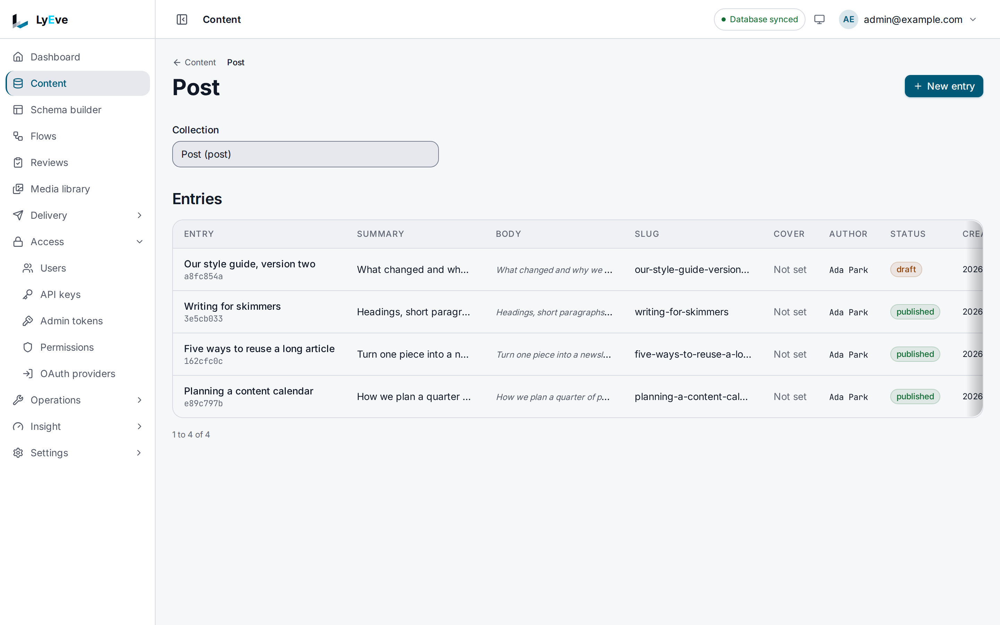

In a collection that uses draft and publish, every entry is either a **draft**, **published**
or **archived**. You save work as a draft and publish it when it is ready. When history is on
for the collection, every change is kept, so you can look back through an entry's history and
bring an earlier version back. This page covers those steps in the admin console. You need the
`admin` or `super_admin` role.

What each status means, and how revisions are kept, is explained on
[the data model](../../concepts/data-model.md#statuses) page. The same steps over the Admin
API, with archiving and scheduling, are in [Content lifecycle](../../features/content-lifecycle.md).

Your site sees a draft only when its credential may also edit the collection. A site that reads
with a read-only key shows published entries alone.

## See an entry's status

Open **Content**, pick the collection and open the entry. In a collection that uses draft and
publish:

- The collection's list has a **Status** column.
- The entry page shows the status in a badge at the top, beside **Publish** or **Unpublish**.

A collection without draft and publish shows no status and no publish buttons. Its entries
are live as soon as they are saved.

## Publish an entry

1. Open the entry.
2. Choose **Save** if you have unsaved changes. Saving keeps the current status, so a draft
   stays a draft.
3. Open the entry again and choose **Publish**.

The badge changes to `published`, and the time is recorded as the entry's publish time.

## Take an entry back to draft

Open a published entry and choose **Unpublish**. The entry becomes a draft again, so you can
keep editing before it goes live. Publishing it again records a new publish time.

## Look back through the history

When history is on for the collection, every save, publish and restore that changes the entry
keeps a revision of it. A save that changes nothing keeps none. History is off until an
administrator turns it on under **Settings > Content history**, for every collection or the
ones they choose. [Content history](../../features/content-history.md) explains the settings
and how long revisions are kept. When the collection keeps no history, the entry page says
**History is off for this type** and an administrator sees a link to turn it on.

To read the revisions:

1. Open the entry.
2. Choose **History**. The number beside it counts the revisions.
3. The **Revision history** panel lists each revision with its date and the fields it held.

The first revision is the entry as it was when history started for it. A revision never
changes once written. Retention may remove older revisions after the time or the count your
administrator set, and always keeps the newest.

## Restore an earlier version

1. In **Revision history**, choose the revision you want.
2. Choose **Restore**.

The entry takes that revision's content and status, and the restore is saved as a new
revision. A restore erases nothing, so it can itself be undone by restoring the revision before
it.

## What the console does not do

These are on the Admin API, in [Content lifecycle](../../features/content-lifecycle.md):

- **Archive** an entry you want to retire but keep.
- **Schedule** an entry to publish or archive itself at a set time.
- **Compare** two revisions field by field.
- **Write a change note** with a save, shown later in the history.

To publish several entries together, open **Releases** in the sidebar, or use the **Release**
card on each entry page. Releases need a license with `content-pro`, and
[Content releases](../../features/content-releases.md) explains how they go out.

To put entries through sign-off before they go live, use
[editorial review](../../features/editorial-review.md). Its **Review** card on the entry page
moves an entry through each stage and can publish it on final approval.

## Where to go next

- [Creating and editing content](content-editing.md): the fields you work with day to day.
- [Roles and permissions](roles-and-permissions.md): who may publish.
- [Content lifecycle](../../features/content-lifecycle.md): archiving, scheduling and
  revisions over the API.
