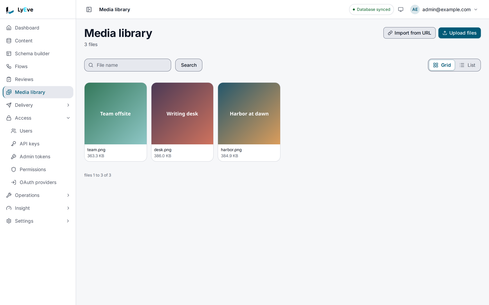

> **Included free** on every install, local disk and S3 storage alike.

The media library keeps your images, documents, video and audio in one place for your tenant.
This page covers it in the admin console: uploading, finding, describing and publishing files,
and putting them in content. Open **Media library** in the sidebar. You need the `admin` or
`super_admin` role.

The same tasks over the Admin API, with every setting, are on [Media](../../features/media.md).

## Upload files

1. Open **Media library** and choose **Upload files**.
2. Pick one or more files. The picker offers images, PDFs, video, audio and text files.
3. A message confirms how many were uploaded, such as **Uploaded 2 files**.

Uploads land in the top folder with no alt text. Add both in the file's details, below.

Each file is checked as it arrives. A file whose content does not match its type is refused,
and SVG files are always refused. A file is limited to 100 MiB by default, but the server
refuses a request over 10 MiB unless your operator raises that limit too. Images get
thumbnails on their own.

## Import a file from another site

1. Choose **Import from URL**.
2. Enter the file's **Address**, and **Alt text** for an image.
3. Check **Publish it, so a site or a content field can use its address** if you will use it
   in content right away.
4. Choose **Import**.

Private and internal addresses are refused.

## Find a file

- Type in the **File name** box and choose **Search**. It also matches alt text and tags.
  **Clear** shows everything again.
- Switch between **Grid** and **List**. The list shows each file's **Name**, **Type**,
  **Size** and when it was **Uploaded**.

## Describe a file

Choose a file to open its **Preview**. It shows the file with its name, type, size,
dimensions and upload time. Under **Details**:

- **Alt text**: what the image shows, for readers who cannot see it. Set it on every image
  you publish. With the [AI](../../features/ai.md) feature running, **Suggest alt text**
  drafts it for you to review.
- **Tags**: separated by commas. Search finds a file by its tags. New uploads carry a tag for
  their kind, such as `image`, and saving your own replaces it.
- **Folder**: lower-case letters, digits, `_`, `-` and `/`, such as `/products/2026`.

Choose **Save** to keep the changes.

## Publish a file

A file is **Private** until you publish it: only signed-in operators can open it. To give it
an address a site or a content field can use, open its **Preview** and choose **Publish**. The
badge changes to **Published** and **Public path** shows the address, with **Copy URL**. For an
image you can also **Copy as Markdown** or **Copy as HTML**.

**Unpublish** takes the address back. Anyone who loads it afterwards gets a not-found answer.

## Use a file in content

A media field on an entry stores the file's public path.

1. Publish the file first.
2. Open the entry. Beside the media field, choose **Choose from library**.
3. In **Choose a file**, search by file name or alt text and pick the file.

The picker lists published files only. If it says **No published files**, publish one first.
You can also paste the full address of a file hosted elsewhere into the field.

## Download or delete a file

In the file's **Preview**, **Download** saves the original. **Delete** removes the file, its
thumbnails and its details, after you confirm. This cannot be undone, and an entry that
pointed at the file keeps a link that no longer works.

## Where files are kept

Your operator decides once for the instance whether files go to local disk or to an S3
compatible store. The library works the same either way. See
[Object storage](../../features/object-storage.md).

## Where to go next

- [Creating and editing content](content-editing.md): the media field and every other kind.
- [Media](../../features/media.md): the API, the limits and the settings.
