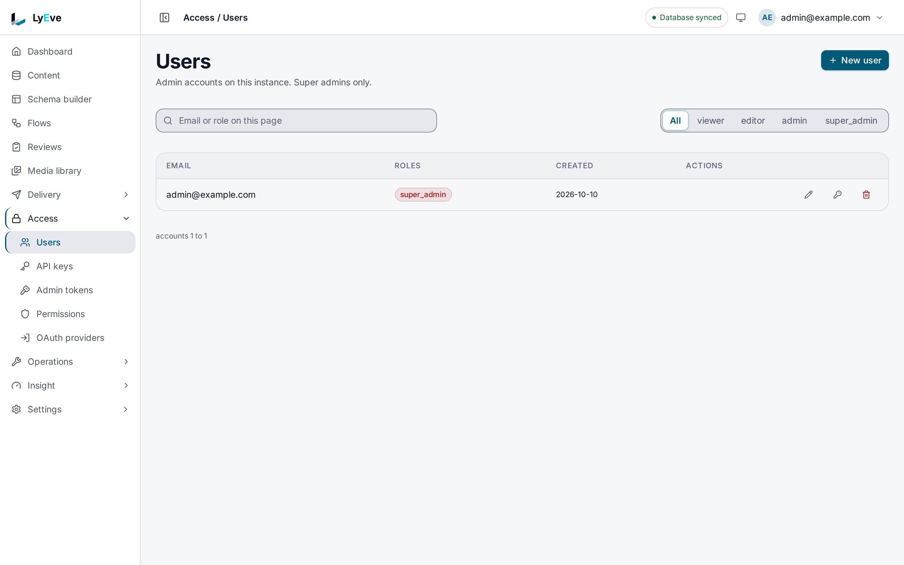
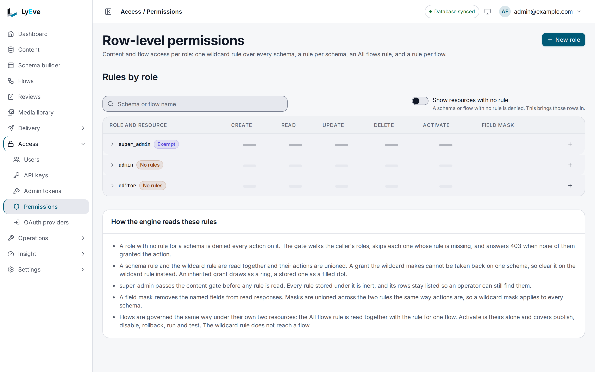

Every request LyEve receives answers one question first: may this caller do
this? For a person, the answer comes from their **role** and, for content, the
[access rules](../../features/access-rules.md) written for that role. For a
program, it comes from the credential it holds. This page says which
credential to use, what each role may do, and how to manage accounts.

## Which credential do I need?

| Who is calling | Use | Sent as | Home page |
|---|---|---|---|
| A person in the admin console, or code acting for them | A session from signing in | The console's cookie, or `Authorization: Bearer <token>` | [Quickstart](../../getting-started/quickstart.md) |
| A site or app reading content | An API key with scopes | `X-API-Key: ly_...` | [API keys](../../features/api-keys.md) |
| A script or CI job on the Admin API | An admin token with grants | `Authorization: Bearer lyat_...` | [Admin tokens](../../how-to/admin-tokens.md) |
| A service checking who a caller is | The public key, to verify a session token | `GET /.well-known/jwks.json` | [Validate tokens](../../integrations/validate-tokens-jwks.md) |

People can also sign in through an identity provider or a magic link. See
[sign-in options](../../integrations/oauth-sso.md).

## Roles

A role is a name on an account. Three names have built-in meaning:

| Role | Reach | What it may do |
|---|---|---|
| `super_admin` | Every tenant | Everything: users and their roles, access rules, sign-in providers, the license, tenants and every setting. Never limited by an access rule. |
| `admin` | Its own tenant | Run the tenant in the admin console: content types, content, media, flows, API keys and its own admin tokens. On the Content API it needs an access rule like any other role. |
| `editor` | Its own tenant | Create, change, publish and delete entries through the Content API, where an access rule allows it. A user created without a role gets this one. |

Any other role name is yours to define. It opens no admin route on its own,
and reaches content only through the access rules written for it.

:::caution
A fresh install has no access rules, so on the Content API only super admins
read or write content until you write some. Write rules before you hand out
accounts. See [access rules](../../features/access-rules.md#try-it).
:::

## Manage users



A super admin manages accounts in **Access > Users**, or through these routes
from a signed-in session:

| Method | Path | Does |
|---|---|---|
| `GET` | `/api/admin/users` | List users. |
| `POST` | `/api/admin/users` | Create a user: `email`, `password`, `roles`. `201`. |
| `PUT` | `/api/admin/users/{id}/roles` | Replace a user's roles: `{"roles": [...]}`. |
| `PUT` | `/api/admin/users/{id}/state` | Disable or enable a user, or set an account expiry: `disabled`, `expires_at`. |
| `PUT` | `/api/admin/users/{id}/password` | Set a new password. It has to meet the password policy, and every session the user held ends. |
| `DELETE` | `/api/admin/users/{id}` | Delete a user. `204`. |
| `GET` | `/api/admin/users/{id}/memberships` | List the tenants a user belongs to. |
| `PUT` | `/api/admin/users/{id}/memberships` | Give a user membership of a tenant. |
| `DELETE` | `/api/admin/users/{id}/memberships/{tenant}` | Remove a membership. |

Roles are held per membership, so one person can be an `editor` in one tenant
and an `admin` in another.

A free install holds three admin seats: accounts with the `admin` or
`super_admin` role, counted across every tenant. Creating a fourth, or giving a
fourth account one of those roles, answers `402` with `cap_exceeded` until a
license is in force. Access rules cover three roles until a license carries
`rbac-pro`. See
[licensing and tiers](../../concepts/licensing-and-tiers.md#what-runs-free).

Create an editor:

```bash
curl -X POST http://localhost:3001/api/admin/users \
  -H "Authorization: Bearer $TOKEN" \
  -H "Content-Type: application/json" \
  -d '{"email": "sam@example.com", "password": "Editor-Account-2026"}'
```

The answer is `201` with the user and `"roles": ["editor"]`. The password must
meet the policy: by default at least 12 characters, with an upper-case letter,
a lower-case letter and a digit, and not a common password.

## `super_admin` and the tenant boundary

The difference between a tenant `admin` and a `super_admin` is the most
important boundary on an instance with several tenants.

- An `admin` works only inside the tenant its session belongs to. An
  `X-Tenant-ID` header has no effect on its requests.
- A `super_admin` may act in any tenant by sending `X-Tenant-ID` with the
  tenant's slug. A slug that names no tenant answers `404` with
  `tenant not found`.
- Deleting a tenant, managing users, writing access rules and configuring
  sign-in providers take `super_admin`.

Treat `super_admin` like root and give it to as few people as possible. See
[tenants](../../features/tenants.md).

## How access is checked



Every request goes through the same steps, in order:

1. **Who is calling.** The session, the API key or the admin token becomes a
   caller. No valid credential answers `401`.
2. **The route's role.** Each route is public, open to any signed-in caller,
   or limited to `admin` and `super_admin`, or to `super_admin` alone. A
   caller without the role answers `403`.
3. **The tenant.** The request is held to the caller's tenant, or to the
   tenant a `super_admin` named.
4. **The credential's own limits.** An API key needs the scope the route
   needs. An admin token needs the grant the route declares.
5. **The access rule.** On content, flows and reviews, the caller's roles need
   a rule that allows the action. Access rules apply to people who sign in,
   not to API keys.

`401` means "I do not know who you are": fix the credential. `403` means "I
know who you are, and you may not do this": fix the role, the rule, the scope
or the grant.

## Practical guidance

- **Grant the narrowest role that works.** Keep `super_admin` for the people
  who need every tenant.
- **Write access rules before you add editors.** Without a rule, an editor can
  sign in and reach no content.
- **Give programs their own credential.** A key or a token is logged and
  revoked on its own, and a shared account is neither.
- **Set an expiry on every key and token.** A credential that has to be
  rotated cannot linger forgotten.

## Related pages

- [Access rules](../../features/access-rules.md): write and combine rules.
- [API keys](../../features/api-keys.md): credentials for the Content API.
- [Admin tokens](../../how-to/admin-tokens.md): credentials for scripts on the
  Admin API.
- [Harden your instance](../../how-to/secure-your-instance.md): the settings a
  production instance needs.
