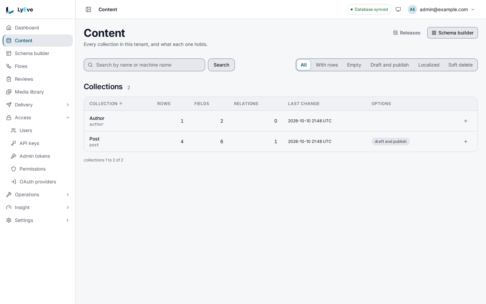

There are two ways to find content in the admin console. Browsing works on every install:
narrow the list of collections, open one, and page through its entries. Full-text search
finds entries by the words in them, and needs a license with the [Search](../../features/search.md)
feature. This page covers both in the console. You need the `admin` or `super_admin` role.

To filter and page entries from your own code, see
[Content lifecycle](../../features/content-lifecycle.md#find-and-read-entries) for the Admin
API and [the data model](../../concepts/data-model.md#entries) for the Content API.

## Browse collections

> **Included free** on every install.

Open **Content**. The page lists every collection in your tenant.

- **Find a collection.** Type part of its name in **Search by name or machine name** and
  choose **Search**.
- **Narrow the list.** The chips above the table show **All**, **With rows**, **Empty**,
  **Draft and publish**, **Localized** or **Soft delete** collections.
- **Sort.** Choose the **Collection**, **Rows**, **Fields** or **Last change** column header
  to sort by it.

## Page through entries

Open a collection to see its entries, the most recently changed first.

- The **Entry** column shows each entry's name with the start of its id. A collection with
  draft and publish also has a **Status** column.
- The pager under the table moves between pages and shows the total.
- The **Collection** box at the top jumps to another collection without going back.

The entry list has no status filter and no sort. To find entries by their words, or to narrow
by status, use search.

## Search by words

> **Requires** a license with the `search` feature. See [pricing](https://lyeve.com/pricing/).

Open **Search**, type in **Search content** and choose **Search**. Search looks in every
entry's title, body and tags, in every collection and every status.

Each result shows the entry's title, its collection and status, its slug and its tags, with
the matching words marked. A `rank` number shows how well it matched: higher is better, and a
match in the title counts more than one in the body. The page shows the best 20 matches. If
nothing matches, it says **No results for** and your words.

Without the license, **Search** is not in the sidebar.

## Make search understand your words

The **Search** page holds the settings that shape every search in your tenant.

- **Synonyms.** Choose **New synonym**, enter a **Term** and what it **Also matches**, and
  choose **Create**. A search for exactly the term then finds the other words too, but not the
  other way round. Enter terms in lower case.
- **Ranking weights.** Set how much a match in the **Title**, the **Body** and the **Tags**
  counts, from 0 to 10, and choose **Save**. These apply to every collection that has no
  weights of its own.
- **Public search.** Under **Anyone may search**, check each collection your site may search
  without signing in, and choose **Save**. Your site's developer then calls the public search
  route described on [Search](../../features/search.md#let-anyone-search-your-site).

**Last 30 days** shows how many searches ran and how many found nothing. A `super_admin` also
sees **Rebuild index**, which is needed once after your operator moves search to
Elasticsearch or Meilisearch.

## Where to go next

- [Search](../../features/search.md): the API, analytics and the search backends.
- [Creating and editing content](content-editing.md): open and edit what you find.
- [Drafts and publishing](drafts-and-publishing.md): what each status means.
