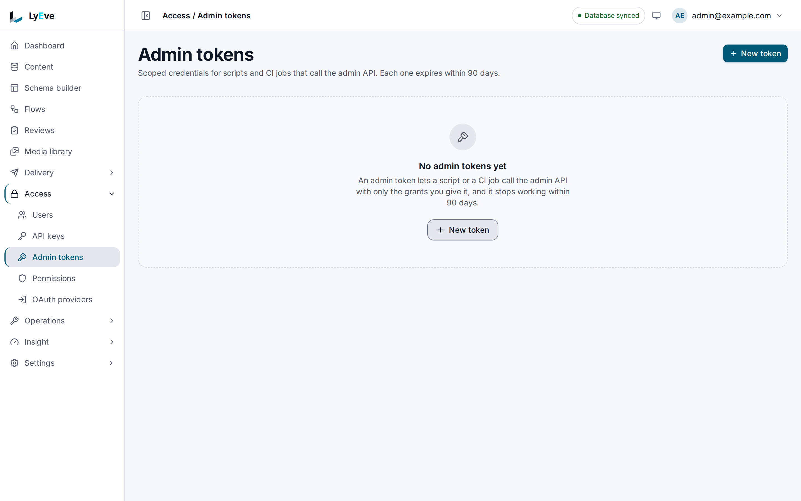

> **Included free** on every install.

An admin token is the credential for a machine that calls the Admin API
(`/api/admin/*`): a CI job that pulls the content model, a script that
publishes entries, an integration that reads logs. It keeps automation off a
person's password. A token is narrower than the person who created it: it acts
in one tenant, reaches only the routes its grants open, stops working on a date
at most 90 days out, can be limited to a list of addresses, and logs every call
it makes, refused calls included.

:::note[Use something else when]
- A site or app reads content. Use an [API key](../features/api-keys.md) on the
  Content API.
- You need to manage users, roles, keys, sign-in providers or the license.
  Those routes take a signed-in person, never a token. See
  [what never takes a token](#what-never-takes-a-token).
:::

## Before you start

- You hold `admin` or `super_admin` in the tenant the token will act in.
- You can sign in, and you know your password, or your authenticator code if
  your account has [MFA](../features/multi-factor-auth.md). Creating and
  rotating a token asks for it again.
- You have a session token in `TOKEN`. The
  [quickstart](../getting-started/quickstart.md) shows how to get one.

## 1. Create the token

In the admin console, open **Access > Admin tokens** and choose **New token**:



1. **Name** the job, such as `ci-schema-pull`.
2. **Grants.** Pick only what the job calls. Each group lists the routes its
   grants open on your instance.
3. **Expires.** Choose 7, 30 or 90 days, or pick a day.
4. **Allowed addresses** (optional). One address or CIDR range per line.
5. **Tenant**, when you are a super admin and more than one tenant exists.
6. **Your password**, or **Authentication code** when your account has MFA.

Choose **Create** and copy the token. It is shown once.

The same call over HTTP:

```bash
curl -X POST http://localhost:3001/api/admin/admin-tokens \
  -H "Authorization: Bearer $TOKEN" \
  -H "Content-Type: application/json" \
  -d '{
    "name": "ci-schema-pull",
    "grants": ["schemas:read"],
    "expires_at": "2026-12-01T00:00:00Z",
    "allowed_ips": ["203.0.113.0/24"],
    "password": "<your password>"
  }'
```

An account with MFA sends `"mfa_code": "123456"` in place of `password`. The
answer is `201`:

```json
{
  "id": "5d70664a-99fd-4139-88f4-33bd8c4a7305",
  "tenant_id": "default",
  "owner_user_id": "12dd433d-c110-4809-b476-12ef360afe7f",
  "owner_email": "ops@example.com",
  "name": "ci-schema-pull",
  "display_prefix": "17drForW",
  "grants": ["schemas:read"],
  "allowed_ips": ["203.0.113.0/24"],
  "expires_at": "2026-12-01T00:00:00Z",
  "created_at": "2026-10-01T09:30:00Z",
  "last_used_at": null,
  "revoked_at": null,
  "rotated_from": null,
  "replaced_by": null,
  "token": "lyat_17drForW..."
}
```

Copy `token` into `ADMIN_TOKEN` and `id` into `TOKEN_ID`. Only a hash and the
short `display_prefix` are kept, so a lost token cannot be shown again.

## 2. Use it

Send the token as a bearer token:

```bash
curl http://localhost:3001/api/admin/schemas/export \
  -H "Authorization: Bearer $ADMIN_TOKEN" > schemas.yaml
```

The answer is `200` with the content model as YAML.

In a CI job, keep the token in the CI system's secret store:

```yaml
- name: Pull the content model
  env:
    ADMIN_URL: ${{ vars.ADMIN_URL }}
    ADMIN_TOKEN: ${{ secrets.LYEVE_ADMIN_TOKEN }}
  run: |
    curl -sf "$ADMIN_URL/api/admin/schemas/export" \
      -H "Authorization: Bearer $ADMIN_TOKEN" > schemas.yaml
```

## 3. See what it may not do

```bash
curl http://localhost:3001/api/admin/flows \
  -H "Authorization: Bearer $ADMIN_TOKEN"
```

```json
{ "code": "forbidden", "error": "This token is not granted flows:read." }
```

A route that takes no grant, such as `/api/admin/users`, answers
`403 This route needs a signed-in session.`, and the Content API answers
`401 Admin tokens are accepted on the admin API only.`

## 4. Read its request log

```bash
curl "http://localhost:3001/api/admin/admin-tokens/$TOKEN_ID/requests?limit=50" \
  -H "Authorization: Bearer $TOKEN"
```

```json
{
  "data": [
    { "id": "9f4d45ce-...", "token_id": "5d70664a-...", "tenant_id": "default", "method": "GET", "route_pattern": "/api/admin/flows", "status": 403, "client_ip": "203.0.113.7", "created_at": "2026-10-01T09:31:02Z" },
    { "id": "38c1bb90-...", "token_id": "5d70664a-...", "tenant_id": "default", "method": "GET", "route_pattern": "/api/admin/schemas/export", "status": 200, "client_ip": "203.0.113.7", "created_at": "2026-10-01T09:31:00Z" }
  ],
  "limit": 50,
  "offset": 0,
  "total_count": 2
}
```

Each row records the route pattern, such as `/api/admin/schemas/{name}`, not
the path with its values. The console shows the same log from the token's row.

## 5. Rotate it before it expires

Rotation issues a successor with the same name, grants, tenant and address
list, and a new expiry. Only the owner can rotate a token, with the same
password or MFA confirmation as creation. In the console, choose **Rotate** on
the token. Over HTTP:

```bash
curl -X POST http://localhost:3001/api/admin/admin-tokens/$TOKEN_ID/rotate \
  -H "Authorization: Bearer $TOKEN" \
  -H "Content-Type: application/json" \
  -d '{"expires_at": "2027-02-01T00:00:00Z", "password": "<your password>"}'
```

The answer is `201` with the new token, once, and `rotated_from` naming the
old one. The old token keeps working for seven days or until its own expiry,
whichever comes first, so a job can switch without a gap. A revoked or expired
token cannot be rotated: that answers `409`.

## 6. Revoke it

```bash
curl -X DELETE http://localhost:3001/api/admin/admin-tokens/$TOKEN_ID \
  -H "Authorization: Bearer $TOKEN"
```

The answer is `204`, or `409 This admin token is already revoked.` From then
on the token answers `401 This admin token has been revoked.` A revoked token
stays in the list with its request log. The owner or a super admin can revoke
a token.

## How a token is checked

- **It acts for its owner.** On every request the owner is read again. The
  token answers `401` when the owner is deleted, disabled, past their account
  expiry, erased, or no longer holds `admin` or `super_admin` in the token's
  tenant. Signing out or changing the owner's password does not end a token.
- **It never carries `super_admin`.** An owner who is a super admin acts
  through the token as an admin of its tenant. Routes that need `super_admin`
  refuse every token.
- **It is bound to one tenant.** A request whose `X-Tenant-ID` names another
  tenant is refused with `403`, whoever the owner is. Sending no `X-Tenant-ID`
  is the normal case.
- **Addresses.** A bare address is stored as a one-address range
  (`127.0.0.1` becomes `127.0.0.1/32`), and a list holds at most 100 entries.
  An empty list allows any address. The address checked is the connection's
  peer, or the forwarded address when the peer is in `TRUSTED_PROXIES`. Behind
  a load balancer, set `TRUSTED_PROXIES` or every request appears to come from
  the balancer.
- **Logging.** Every request made with a token writes one row, refused ones
  included. Under heavy load some rows can be dropped, and they are counted: a
  row with status `0`, an empty method and the route pattern `dropped:<n>`
  records `n` requests that were not logged. Rows older than 90 days are
  deleted. **Last used** is updated at most once a minute. The audit log
  records each creation, rotation and revocation as `admin_token.create`,
  `admin_token.rotate` and `admin_token.revoke`.

## Grants

A grant names one kind of work. The catalog is closed: a token asking for a
name outside it is refused at creation.

| Grant | What it opens |
|---|---|
| `content:read` | Read content entries and their revisions. |
| `content:write` | Create, update, publish and delete content entries. |
| `media:read` | List and download media files. |
| `media:write` | Upload, replace and delete media files. |
| `schemas:read` | Read schema definitions, their row counts and the schema export. |
| `flows:read` | Read flows and their runs. |
| `flows:write` | Create, change, activate and delete flows. |
| `webhooks:read` | Read webhooks and their deliveries. |
| `webhooks:write` | Send a test delivery, retry a delivery and change a webhook's retry settings. Creating, changing and deleting a webhook take a super admin, so no token can. |
| `jobs:read` | Read scheduled jobs and their runs. |
| `jobs:write` | Create, change, trigger and delete scheduled jobs. |
| `logs:read` | Read and export the instance logs. |
| `audit:read` | Read and export the audit log. |

Each grant opens routes of one feature, so it opens nothing where that feature
is not running: `webhooks:read` does nothing without
[webhooks](../features/webhooks.md). `GET /api/admin/admin-tokens/grants`
lists the routes each grant opens on your instance, and the admin OpenAPI
document marks each one with an `x-admin-grant` extension.

## What never takes a token

Whatever grants a token holds, a route that declares no grant is served to a
signed-in person only, and so is every route that needs `super_admin`. That
covers:

- **Who can get in.** Users and their roles, tenant memberships, access rules,
  API keys, admin tokens themselves, MFA, account links, and the OAuth, SAML
  and SCIM providers.
- **What the install is.** The license, the configuration and a feature's
  configuration.
- **Destruction across tenants.** Schema import, and deleting, archiving and
  restoring a tenant.
- **Personal data in bulk.** Privacy export and erasure.
- **Process internals.** The profiling routes and the garbage collector
  settings.

Run those as a signed-in person, in the console or with a session token. See
[keep the content model and flows in git](schema-and-flows-as-code.md) for
schema import.

## Refusals

A `401` means the token itself is not usable. A `403` means the token is fine
and this request is not one it may make.

<details>
<summary>Every refusal a token can meet</summary>

| Status | Message | Meaning |
|---|---|---|
| `401` | `This admin token is not valid.` | No such token: mistyped, or never issued here. |
| `401` | `This admin token has expired.` | Past its expiry. Rotate before it lapses. |
| `401` | `This admin token has been revoked.` | Revoked in the console or through the API. |
| `401` | `The owner of this admin token can no longer use it.` | The owner is deleted, disabled, expired or erased, or no longer an admin of the token's tenant. |
| `401` | `Admin tokens are accepted on the admin API only.` | Sent to the Content API or a public route. |
| `403` | `This route needs a signed-in session.` | The route declares no grant. |
| `403` | `This token is not granted <grant>.` | The route needs a grant the token does not hold. |
| `403` | `An admin token acts only in the tenant it was issued for.` | `X-Tenant-ID` names another tenant. |
| `403` | `This admin token is not allowed from this address.` | The client address is outside the token's list. |
| `404` | `not found` | No route matches the path. |

</details>

<details>
<summary>Why creating or rotating can fail</summary>

| Status | When |
|---|---|
| `403` | The password or MFA code is missing or wrong, the MFA code was already used once, or you are not an admin of the token's tenant. |
| `429` | Too many wrong passwords or codes: the account's sign-in lockout applies here too. |
| `422` | No name, no grants, a grant outside the catalog, no expiry, an expiry more than 90 days away, more than 100 addresses, or an address entry that is not an IP address or CIDR range. |

</details>

## API keys with an admin role

The Admin API refuses an API key that holds `admin` or `super_admin` with
`401 API keys with an admin role are not accepted on the admin API. Use an admin token.`
and a `Link` header with `rel="deprecation"` pointing at this page. The
instance logs the key's id, its tenant and the route at most once an hour per
key, so the automation still sending one can be found. Move it to an admin
token.

## Next

- [Harden your instance](secure-your-instance.md): the settings a production
  instance needs.
- [Roles and permissions](../guides/user/roles-and-permissions.md): which
  credential fits which job.
- [API keys](../features/api-keys.md): the credential for the Content API.
