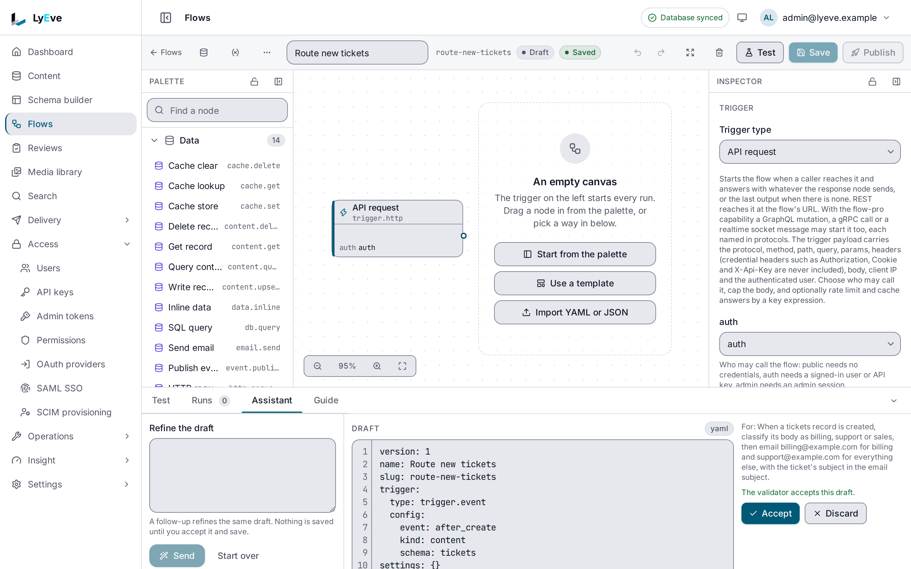

> **Requires** a license with the `ai` feature. See [pricing](https://lyeve.com/pricing/).

Instead of dragging nodes onto the canvas, you can tell the flow editor what
you want and get a draft back. This guide builds one flow that way: when a
support ticket is created, classify it and email the right team. The assistant
drafts against your instance's own node catalog and checks every draft before
you see it. It never saves or publishes anything: you accept, save, test and
publish, as with a flow you drew by hand.

## Before you start

- **AI is set up.** Your license carries `ai`, the tenant's AI switch is on
  on the **Settings** tab of **Operations > AI**, and the tenant has an
  enabled provider. See [AI](../features/ai.md#connect-a-provider).
- **The nodes you ask for are licensed.** The example uses `ai.classify` and
  `email.send`, which need `flow-pro` as well. The assistant may draft a node
  your license does not cover, and then saving the flow answers `402`. See
  [free and flow-pro](../features/flows.md#free-and-flow-pro).
- **An email sender** is configured, for the example's mail. See
  [email](../features/email.md).
- **A `tickets` content type** with `subject` and `body` fields.
- **For the console steps**, you are signed in to the admin console as an
  admin. **For the API steps**, you need an admin token in `TOKEN` and `jq`.
  The [quickstart](../getting-started/quickstart.md) shows how to get a
  token.

## 1. Open the assistant

<div class="paths">
<div data-path="console">

Open **Flows** in the admin console and open a flow, new or existing. The
drawer below the canvas has the tabs **Test**, **Runs**, **Assistant** and
**Guide**. **Assistant** opens with a box headed "Describe the flow" and a
note saying what is sent: the flow on the canvas, the node catalog and your
prompt, to the provider configured for this tenant.

What the tab says after you press **Send** tells you what is missing:

| The tab says | What to fix |
|---|---|
| "The assistant is switched off" | The tenant's AI switch is off on the **Settings** tab of **Operations > AI**, or the license does not carry `ai`. |
| "The assistant is not available on this engine" | Read the message under it. `no enabled AI provider configured` means the tenant needs an enabled provider. |

</div>
<div data-path="api">

The assistant needs the node catalog in every request. Save it to a file:

```bash
curl http://localhost:3001/api/admin/flows/catalog/llm \
  -H "Authorization: Bearer $TOKEN" -o catalog.md
```

With the tenant's AI switch off, the assistant answers `404` with
`AI is switched off for this tenant`. With no enabled provider, it answers
`503` with `no enabled AI provider configured`.

</div>
</div>

If the [web application firewall](../features/web-application-firewall.md)
refuses the request with `403` and `request blocked by WAF`, read the rule
ids on `/api/admin/ai/assist/flow` in the violation log, and
[add an exception](../features/web-application-firewall.md#add-an-exception)
for each one on the path `/api/admin/ai/assist/flow*`.

## 2. Describe the flow

Say what starts it, what it reads and what it does. Name your content types,
fields and addresses, because the assistant knows the catalog, not your
content model:

```text
When a tickets record is created, classify its body as billing, support or
sales, then email billing@example.com for billing and support@example.com for
everything else, with the ticket's subject in the email subject.
```

<div class="paths">
<div data-path="console">

Type it in the box and press **Send**. The panel shows "Drafting the flow"
while the provider answers, then a line with the model, the tokens and the
estimated cost of the turn.

</div>
<div data-path="api">

```bash
jq -n --rawfile catalog catalog.md \
  --arg prompt "When a tickets record is created, classify its body as billing, support or sales, then email billing@example.com for billing and support@example.com for everything else, with the ticket's subject in the email subject." \
  '{prompt: $prompt, catalog: $catalog}' > draft.json

curl -X POST http://localhost:3001/api/admin/ai/assist/flow \
  -H "Authorization: Bearer $TOKEN" \
  -H "Content-Type: application/json" \
  --data-binary @draft.json -o answer.json
```

`answer.json` carries `definition`, the same draft as `yaml`, `problems`,
`conversation_id`, `model`, `tokens` and `cost`.

</div>
</div>

## 3. Read the draft

The answer is a YAML draft. Yours will differ in names and layout, but it
looks like this:

```yaml
version: 1
name: Route new tickets
slug: route-new-tickets
trigger:
  type: trigger.event
  config:
    kind: content
    schema: tickets
    event: after_create
nodes:
  - id: classify
    type: ai.classify
    position: { x: 120, y: 200 }
    config:
      input: "{{ trigger.data.body }}"
      labels: [billing, support, sales]
  - id: route
    type: control.switch
    position: { x: 400, y: 200 }
    config:
      cases:
        - port: billing
          when: input.label == 'billing'
  - id: email_billing
    type: email.send
    position: { x: 680, y: 120 }
    config:
      to: [billing@example.com]
      subject: "Billing ticket: {{ trigger.data.subject }}"
      text: "{{ trigger.data.body }}"
  - id: email_support
    type: email.send
    position: { x: 680, y: 280 }
    config:
      to: [support@example.com]
      subject: "Ticket: {{ trigger.data.subject }}"
      text: "{{ trigger.data.body }}"
edges:
  - { from: classify, to: route }
  - { from: route, from_port: billing, to: email_billing }
  - { from: route, from_port: default, to: email_support }
```

<div class="paths">
<div data-path="console">

The draft is shown read-only under **Draft**, beside your prompt. Under it,
the panel either says "The validator accepts this draft." or lists what is
still wrong. Each line names the node, or `flow`, with the path to the
setting, then the problem:

```text
email_billing/config/to   required
```

Clicking a line brings that part of the draft into view, and selects the node
on the canvas when one with that id is there. **Accept** stays disabled while
a problem remains, and says why.



</div>
<div data-path="api">

Read the draft as YAML:

```bash
jq -r .yaml answer.json
```

`problems` is an empty list when the validator accepts the draft. Otherwise
each entry has `node_id`, `path` and `message`.

</div>
</div>

The assistant gets one repair pass: the problems go back to the model once,
and whatever remains is shown rather than hidden.

:::caution[Email addresses with PII masking]
With [PII masking](../features/pii-masking.md) licensed, the draft comes back
with every email address replaced by `[redacted-email]`, in the console and
over the API. A draft you accept and save keeps `[redacted-email]` as the
recipient. Put the real addresses back in the inspector, or in the
definition, before you save.
:::

## 4. Accept it

<div class="paths">
<div data-path="console">

Press **Accept**. The draft replaces what is on the canvas, and the editor
says "Draft accepted. Save to keep it." The flow keeps its own slug. Nothing
is stored until you press **Save**, and leaving the page without saving drops
the draft. **Discard** closes the draft and the conversation instead.

</div>
<div data-path="api">

Create the flow as a draft from the answer:

```bash
jq '{name: .definition.name, slug: .definition.slug, definition: .definition}' \
  answer.json > flow.json

curl -X POST http://localhost:3001/api/admin/flows \
  -H "Authorization: Bearer $TOKEN" \
  -H "Content-Type: application/json" \
  --data-binary @flow.json
```

The answer is `201` with the new flow.

</div>
</div>

Then follow the usual path: run a test with a sample trigger payload, and
publish. See [Flows](../features/flows.md). In a test run `ai.classify`
answers the first label and calls no provider, unless you turn on live side
effects.

## 5. Refine it

Say what to change rather than describing the flow again:

```text
Also send sales tickets to sales@example.com, and put the label in every
email subject.
```

<div class="paths">
<div data-path="console">

After the first answer the box reads "Refine the draft". Type the change and
press **Send**. Each answer is checked the same way and replaces the draft in
the panel. The canvas changes only when you accept. **Start over** clears the
conversation.

</div>
<div data-path="api">

Send the change with the draft as `current` and the same `conversation_id`:

```bash
jq --rawfile catalog catalog.md \
  --arg prompt "Also send sales tickets to sales@example.com, and put the label in every email subject." \
  '{prompt: $prompt, catalog: $catalog, current: .definition, conversation_id: .conversation_id}' \
  answer.json > refine.json

curl -X POST http://localhost:3001/api/admin/ai/assist/flow \
  -H "Authorization: Bearer $TOKEN" \
  -H "Content-Type: application/json" \
  --data-binary @refine.json -o answer.json
```

</div>
</div>

Refining needs the tenant to store transcripts, because the conversation is
kept as one. With storage off, the answer carries no `conversation_id`, and
each prompt starts fresh from the definition it is sent.

## 6. Ask about a node or a problem

<div class="paths">
<div data-path="console">

- **A node.** Select it on the canvas and press the wand button in the
  inspector, "Ask the assistant about this node". The answer appears under
  "About" and the node's name.
- **A problem.** Open the problem count in the toolbar, such as
  **1 problem**. "Fix these before publishing" lists each problem with a
  wand button beside it. Press it to ask the assistant about that problem.

</div>
<div data-path="api">

Send the definition with a `node_id` and a `question`:

```bash
jq --rawfile catalog catalog.md \
  '{catalog: $catalog, definition: .definition, node_id: "classify", question: "What does this node do?"}' \
  answer.json > ask.json

curl -X POST http://localhost:3001/api/admin/ai/assist/flow/explain \
  -H "Authorization: Bearer $TOKEN" \
  -H "Content-Type: application/json" \
  --data-binary @ask.json
```

The answer carries `answer`, `model`, `tokens` and `cost`. To ask about a
problem, send `problem`, with its `node_id`, `path` and `message`, in place
of `node_id`.

</div>
</div>

The answer explains what the node does in this flow, or what the problem
means and how to fix it. The assistant never changes the canvas for you.

## What is recorded, and what is sent

Every draft, follow-up and question is part of a transcript of kind
`flow_assistant`, with the prompt, the answer, the model, the tokens, the
latency and the estimated cost of each turn. Read them on the
**Transcripts** tab of **Operations > AI**, or with
`GET /api/admin/ai/transcripts?kind=flow_assistant`. They follow the
retention, switches and privacy handling on the
[AI](../features/ai.md#read-and-recap-transcripts) page.

The request to your provider carries the tenant's `flow_assistant` prompt, the
node catalog, the definition on the canvas, your prompt, the earlier turns of
the conversation and any problems found in the draft. Content entries,
provider keys and other tenants' flows never go. See
[what never leaves your instance](../features/ai.md#what-never-leaves-your-instance).

## Next

- [The flow catalog for language models](../reference/flow-catalog-for-language-models.md):
  draft flows with a model of your own instead.
- [Flow definition format](../reference/flow-definition.md): every node and
  setting the assistant can use.
- [Flow templates](flow-templates.md): starter flows, among them
  `comment-moderation`, which can use `ai.classify`.
