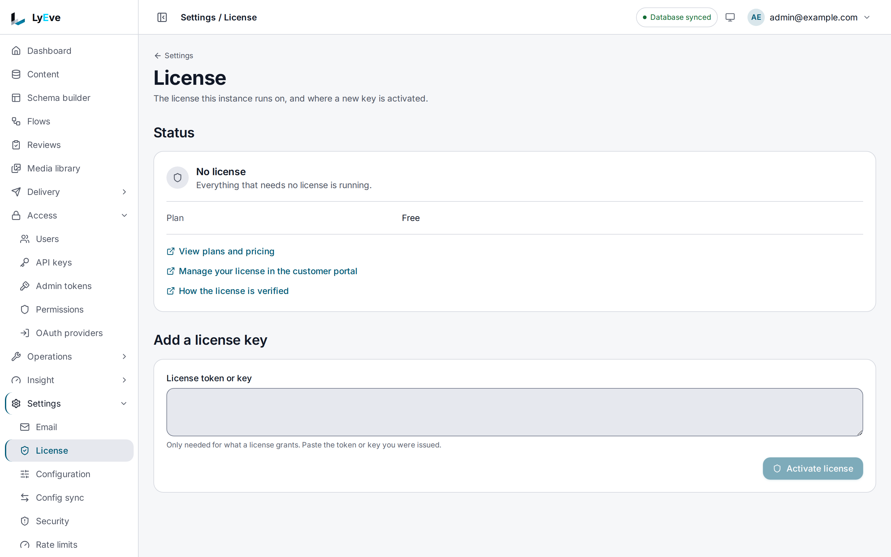

> **Included free** on every install.

A setting changes in three steps: edit it where your deployment keeps it, restart the piece
that reads it, then check the value the engine reports. This page walks through each step for
Docker Compose, plain Docker and Kubernetes, and lists the settings that need care.
[Configuration](../reference/configuration.md) lists every setting and what it does.

## Before you start

- A running instance. [Run the engine and the console together](../getting-started/engine-and-console.md)
  starts one on your computer.
- A `super_admin` account, to read **Settings > Configuration**.

## 1. Find where the setting lives

The engine reads each setting from up to three places. The first one that has it wins:

| Place | Who sets it | When a change applies |
|---|---|---|
| An environment variable | Whoever deploys the engine | At the next restart |
| The YAML file, `lyeve.yaml` | Whoever deploys the engine | At the next restart |
| The admin console | A `super_admin`, on **Settings > Configuration** or a feature's own settings page | At once for most settings, otherwise at the next restart |

A setting none of them sets takes the engine's default. Open **Settings > Configuration** to see
which place each value came from:


Each row names the setting, its current value and its source. A secret shows
**Stored, not shown**. A value set by an environment variable or the file is read-only on this
page, because the higher place would win anyway. Search by a variable's name or by what it does.

The console has a few settings of its own, which only the console container reads: `ORIGIN`,
`CORE_INTERNAL_URL`, `CORE_API_INTERNAL_URL`, `PORT`, `ADMIN_CONSOLE_KEY`, `ADDRESS_HEADER` and
`XFF_DEPTH`. They live in the console's environment, and a change restarts the console, not the
engine. [Docker images](../deploy/docker.md#the-admin-image) explains each one.

## 2. Make the change

### Docker Compose

Edit the variable under the service's `environment`, or its value in `.env`, then apply it:

```bash
docker compose up -d
```

Compose recreates only the containers whose settings changed and leaves the rest running. Do not
use `docker compose restart` for this. It restarts a container with the settings it was created
with, so the edit does nothing.

### Plain Docker

A container keeps the environment it was created with. Remove it and run it again with the new
value. The data lives in the database and the volumes, so nothing is lost:

```bash
docker rm -f lyeve-engine
docker run -d --name lyeve-engine \
  -e JWT_EXPIRY_SECS=1800 \
  ...the other settings, unchanged...
  ghcr.io/lyeve-labs/lyeve-core:latest
```

Keep the command in a script or a file, so the next change starts from the full list rather than
from memory.

### Kubernetes

Change the value in the ConfigMap, or in the Secret for a secret, then restart the engine:

```bash
kubectl rollout restart deployment/<engine deployment>
```

A changed ConfigMap or Secret does not restart running pods. Until the rollout, they keep the old
value. [Kubernetes](../deploy/kubernetes.md) shows the manifests.

### The YAML file

Edit `lyeve.yaml` and restart the engine the way your deployment does. A key in the file is the
variable's name in lower case, so `JWT_EXPIRY_SECS` is `jwt_expiry_secs`.
[The YAML file](../reference/configuration.md#the-yaml-file) covers nesting, includes and
`!overridable`.

### In the console

Some settings can be saved in the console, as long as no environment variable or file sets them:

- **Settings > Configuration** saves a setting nothing higher sets. A setting the engine reads
  each time it uses it applies at once, and one it reads only at start applies at the next
  restart. [Where settings come from](../reference/configuration.md#where-settings-come-from)
  names the three that always wait for a restart.
- A feature's settings page, such as **Settings > Email** or **Settings > Storage**, saves that
  feature's settings and credentials. A credential is encrypted and never shown again.
- **Settings > License** activates a license. The paid parts of features that are running apply
  at once, and a paid feature that was not running starts at the next restart.



To let the console take over a setting the environment sets, name it in `LYEVE_OVERRIDABLE` on
the engine. The environment value then stays in force until someone saves another one.

## 3. Check the value the engine uses

After the restart, confirm the engine came back and took the value:

1. `docker compose ps` shows the engine `(healthy)`, or `kubectl rollout status` finishes.
2. **Settings > Configuration** shows the new value and the place it came from.

An engine that refuses to start prints every problem at once in its log
(`docker compose logs engine`), so one restart shows all of them.

The same list is available to a script, with a `super_admin` token. Secrets show no value:

```bash
curl http://localhost:8080/api/admin/config \
  -H "Authorization: Bearer $TOKEN"
```

## Settings that need care

| Setting | What changing it does |
|---|---|
| `ENCRYPTION_KEY` | Stored credentials, two-factor seeds and provider secrets become unreadable. Keep the value for the life of the install |
| The engine's state volume | It holds the key that signs sessions. Losing it signs every user out |
| `DATABASE_URL` | Points the engine at another database. It creates its tables there and starts empty |
| `APP_ENV` | `production`, the default, refuses to start without `SECURE_COOKIE`, `RATE_LIMIT_RPS` and `LYEVE_AUDIT_HMAC_KEY`. See [what production refuses](../reference/configuration.md#what-production-refuses) |
| `LYEVE_PLUGINS` | Starts only the features it lists. A feature left out stops serving its screens and routes |

### Moving the console to a new address

The console's address is written in three settings, on two containers. Change them together:

| Setting | Where | New value |
|---|---|---|
| `ORIGIN` | The console | The address in the browser, such as `https://admin.example.com` |
| `LYEVE_CONSOLE_URL` | The engine | The same address. Password reset and sign-in emails link to it |
| `CORS_ORIGINS` | The engine | The same address, when the console and the APIs are on different origins |

Then restart both. A console whose `ORIGIN` does not match the address in the browser refuses
every form post, and sign-in is the first one you notice.

## Common changes

| To | Change | Where |
|---|---|---|
| Run the paid features | `LYEVE_LICENSE_KEY`, or **Settings > License** | The engine |
| Keep people signed in longer or shorter | `JWT_EXPIRY_SECS`, at most 3600 in production | The engine |
| Send email | **Settings > Email**, or the mail variables in [Configuration](../reference/configuration.md#email) | The engine |
| Keep uploads in a bucket | **Settings > Storage**, or the storage variables in [Configuration](../reference/configuration.md#storage) | The engine |
| Choose the first administrator's setup token | `LYEVE_SETUP_TOKEN` | The engine |
| Serve the console on another port | `PORT`, and the proxy that points at it | The console |

## Next

- [Configuration](../reference/configuration.md): every setting, its default and what production
  refuses.
- [Production checklist](../deploy/production-checklist.md): what to confirm before you take
  traffic.
- [Harden your instance](secure-your-instance.md): the settings a public instance needs.
