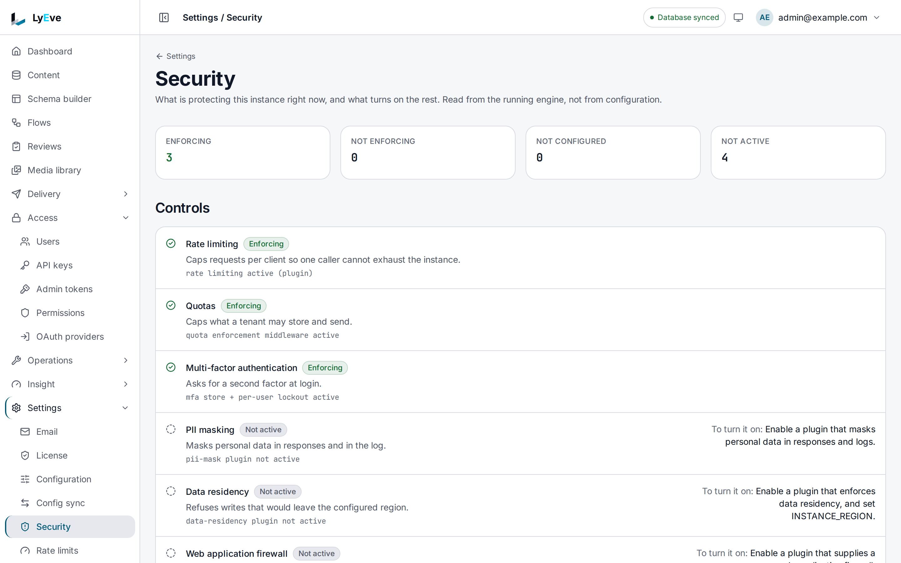

> **Included free** on every install. The web application firewall and trusted devices require a license with the `waf` and `device-fingerprint` features, and passkey enrollment needs `mfa-pro`. See [pricing](https://lyeve.com/pricing/).

Walk these steps before you expose an instance to the internet. Each one says
what to set, why, and how to check that it worked. Every setting is an
environment variable read at start, so restart the instance after you change
one.

## Before you start

- `APP_ENV` is `production`, which is the default. In production the instance
  refuses to start on a weak configuration and names the setting that is
  wrong. `APP_ENV=development` relaxes those checks for local work. Never run
  it on a public address.
- You can read the instance's log, where a refused start explains itself.
- You have a super admin token in `TOKEN` for the checks. The
  [quickstart](../getting-started/quickstart.md) shows how to get one.

Production also refuses a database URL that signs in as the database's
default superuser (`postgres` on PostgreSQL, `root` on MySQL, `sa` on SQL
Server), and a `LYEVE_CONSOLE_URL` that does not use `https`.

## 1. Set strong, separate secrets

```bash
openssl rand -base64 48   # JWT_SECRET
openssl rand -base64 48   # ENCRYPTION_KEY
```

```ini
JWT_SECRET=<generated>
ENCRYPTION_KEY=<generated>
```

**Why:** separate keys mean a leaked signing secret does not also expose the
data stored encrypted, such as MFA secrets and OAuth client secrets.

- `JWT_SECRET` is required. The instance does not start without it, and
  refuses a value shorter than 16 characters or one that looks like a
  placeholder (`change-me`, `example`, `secret` and the like).
- `ENCRYPTION_KEY` must be at least 32 characters and different from
  `JWT_SECRET`. An empty value stops the start in every environment, because
  it falls back to `JWT_SECRET`, which that rule refuses.

Keep both in your secret manager and inject them at runtime.

**Check:** the instance starts. A refused value stops the start with a line
such as `JWT_SECRET too short (12 chars) - must be at least 16 characters`.

## 2. Sign tokens with Ed25519

```ini
JWT_KEY_PATH=/var/lib/lyeve/jwt_key.json
```

**Why:** with an Ed25519 key, other services verify your tokens against the
public key without holding any secret.

Ed25519 is the default (`JWT_ALG=EdDSA`). The instance creates the key pair at
`JWT_KEY_PATH` on first start and reuses it after, so keep that path on
persistent storage, or every restart signs everyone out. In production the
file must be readable by its owner only (`0600`), and a key file the instance
cannot create stops the start.

If you run with `JWT_ALG=HS256` instead, `JWT_SECRET` signs and every secret
in `JWT_SECRETS` verifies. To rotate without signing everyone out, set
`JWT_SECRET` to the new secret and `JWT_SECRETS=new-secret,old-secret`.

**Check:**

```bash
curl http://localhost:3002/.well-known/jwks.json
```

The answer holds one key with `"alg": "EdDSA"`. An empty `keys` list means the
instance signs with HMAC. See
[validate tokens with JWKS](../integrations/validate-tokens-jwks.md).

## 3. Keep token lifetimes short

```ini
JWT_EXPIRY_SECS=900
REFRESH_TOKEN_TTL_SECS=2592000
```

**Why:** a short-lived token limits how long a stolen one is useful.

Session tokens last 900 seconds by default and production refuses more than
`3600`. Refresh tokens last 30 days by default. Signing out, or a password
reset, ends every token already issued to that account.

**Check:** decode a fresh token's payload. `exp` minus `iat` equals
`JWT_EXPIRY_SECS`.

## 4. Serve over TLS and lock cookies

```ini
SECURE_COOKIE=true
```

**Why:** it keeps session cookies and tokens off plain HTTP.

`SECURE_COOKIE=true` marks the session cookies `Secure`, sends
`Strict-Transport-Security: max-age=63072000; includeSubDomains; preload`, and
redirects a plain HTTP request to HTTPS unless the proxy in front says
`X-Forwarded-Proto: https`. Production refuses to start without it. The other
security headers (`X-Content-Type-Options: nosniff`, `X-Frame-Options: DENY`,
`Referrer-Policy` and a Content Security Policy) are sent on every install.

**Check:**

```bash
curl -sI https://admin.example.com/api/admin/auth/me | grep -i strict-transport
```

The header is present.

## 5. Constrain CORS

```ini
CORS_ORIGINS=https://admin.example.com
CORS_ALLOWED_DOMAINS=example.com
```

**Why:** only the origins you list may call the APIs from a browser with the
visitor's session.

The default origin is `http://localhost:5173`, so replace it with your real
console origin. A wildcard `*` in `CORS_ORIGINS` is refused on every install.
`CORS_ALLOWED_DOMAINS` limits the origins a feature may add while the instance
runs, and empty refuses them all.

**Check:** a preflight from another origin gets no
`Access-Control-Allow-Origin` header:

```bash
curl -s -D - -o /dev/null -X OPTIONS https://api.example.com/api/v1/schemas \
  -H "Origin: https://other.example.net" -H "Access-Control-Request-Method: GET"
```

## 6. Pin the Host header and trust proxies on purpose

```ini
ALLOWED_HOSTS=api.example.com,admin.example.com
TRUSTED_PROXIES=10.0.0.0/8
```

**Why:** a forged `Host` header cannot steer a redirect or a link, and a
forged `X-Forwarded-For` cannot change the address that rate limits, audit
entries and admin token address lists see.

- `ALLOWED_HOSTS`: a request whose `Host` is not listed is refused with
  `421 Misdirected Request` before anything is built from it. Empty lets every
  host through.
- `TRUSTED_PROXIES`: the ranges whose `X-Forwarded-For` you trust. The header
  is read only when the connecting peer is in one of these ranges. Empty
  trusts no proxy, so behind a load balancer every request appears to come
  from it.
- `IP_ALLOWLIST` (optional): comma-separated addresses or ranges allowed to
  reach the APIs at all. Others get `403`. Empty allows everyone. An entry
  that is not an address or a range stops the start and names the entry.

**Check:**

```bash
curl -s -o /dev/null -w "%{http_code}\n" https://api.example.com/api/v1/schemas -H "Host: evil.example"
```

The answer is `421`.

## 7. Turn on rate limiting

```ini
RATE_LIMIT_RPS=20
RATE_LIMIT_BURST=40
```

**Why:** one client cannot crowd out the others or hammer an expensive route.

`RATE_LIMIT_RPS` is a per-address ceiling on every request. `0` or unset
turns it off, which production refuses. `RATE_LIMIT_BURST` defaults to twice
the rate, and `RATE_LIMIT_PER_TENANT=true` counts per tenant and address.
Every install also limits sign-in to 5 attempts per address every 15 minutes.
See [rate limiting](../features/rate-limiting.md).

**Check:** responses carry `RateLimit-Limit` and `RateLimit-Remaining`
headers.

## 8. Harden API keys

```ini
API_KEY_PEPPER=<openssl rand -hex 32>
ENFORCE_API_KEY_PEPPER=true
```

**Why:** with a pepper, a copy of the database alone cannot check or forge
keys.

With `ENFORCE_API_KEY_PEPPER=true` the instance does not start without a
pepper. Keys created before the pepper keep working and are upgraded on first
use. Every install also holds these rules:

- A key with the `admin` or `super_admin` role must expire within 90 days, and
  the Admin API refuses it. Give automation on the Admin API an
  [admin token](admin-tokens.md) instead, with an address list.
- Only a signed-in person manages keys, and every request a key makes is
  recorded against it.
- A key's roles go through the same access rules as a person's, and a key
  with a `schemas` list reaches only those content types. Give each key only
  the roles, scopes and content types its job needs. See
  [API keys](../features/api-keys.md).

**Check:** the instance starts with `ENFORCE_API_KEY_PEPPER=true`. Without
the pepper, it stops with a line naming `API_KEY_PEPPER`.

## 9. Tighten the password policy

```ini
PASSWORD_MIN_LENGTH=12
PASSWORD_REQUIRE_COMPLEXITY=true
PASSWORD_CHECK_COMMON=true
PASSWORD_HASH_ALGO=argon2id
```

**Why:** long, uncommon passwords resist guessing, and the hash decides how
costly a stolen password table is to crack.

The values above are the defaults, except `PASSWORD_HASH_ALGO`, which defaults
to `bcrypt` and also takes `argon2id`. Any other value stops the start.
Complexity asks for an upper-case letter, a lower-case letter and a digit.
`PASSWORD_CHECK_COMMON` refuses passwords on a common-password list.

**Check:** creating a user with the password `password1234` answers `422`.

## 10. Protect audit, metrics and debug routes

```ini
LYEVE_AUDIT_HMAC_KEY=<openssl rand -hex 32>
METRICS_TOKEN=<a long random value>
```

**Why:** tampering with the audit log becomes detectable, and a metrics
scraper gets its own credential instead of an admin account.

- `LYEVE_AUDIT_HMAC_KEY` keys the audit log's hash chain. It must be exactly
  64 hex characters, and production does not start without it.
- `METRICS_TOKEN` lets a scraper read `GET /api/admin/metrics` with a static
  bearer token. Once it is set, any other bearer token is refused there, a
  super admin's included. Unset, the route answers any super admin session.
- The profiling routes under `/api/admin/debug/pprof/` take a super admin, and
  the latency ranking at `/api/admin/debug/latency` takes an admin. Treat
  every super admin account as full access to them.

**Check:**

```bash
curl -s -o /dev/null -w "%{http_code}\n" http://localhost:3001/api/admin/metrics \
  -H "Authorization: Bearer $METRICS_TOKEN"
```

The answer is `200`, and a wrong token answers `401`.

## 11. Add the security features

**Settings > Security** in the console shows which of these controls are enforcing on the running
engine, and what turns on the rest:



| Feature | License | What it does |
|---|---|---|
| [Rate limiting](../features/rate-limiting.md) | Free. Custom rules need `rate-limit-pro`. | The global limit and the sign-in protections. Custom rules per endpoint, tenant or role. |
| [Captcha](../features/captcha.md) | Free | A challenge after repeated failed sign-ins. |
| [Multi-factor authentication](../features/multi-factor-auth.md) | Free. Enrolling a passkey needs `mfa-pro`. | A second step at sign-in, and passkeys. |
| [Web application firewall](../features/web-application-firewall.md) | `waf` | Blocks SQL injection, XSS, path traversal, command injection and SSRF on both APIs. A blocked request answers `403` with `X-WAF-Block: true`. |
| [Trusted devices](../features/trusted-devices.md) | `device-fingerprint` | Scores each sign-in for risk, asks for the second factor when it looks risky, and blocks brute force on every sign-in route. |

Register firewall exceptions for false positives instead of turning rules off.
See [licensing and tiers](../concepts/licensing-and-tiers.md) for how a
license reaches the instance.

## Next

- [Production checklist](../deploy/production-checklist.md): everything to
  confirm before you go live.
- [Admin tokens](admin-tokens.md): credentials for automation on the Admin
  API.
- [Tenants](../features/tenants.md): if you run more than one tenant.
