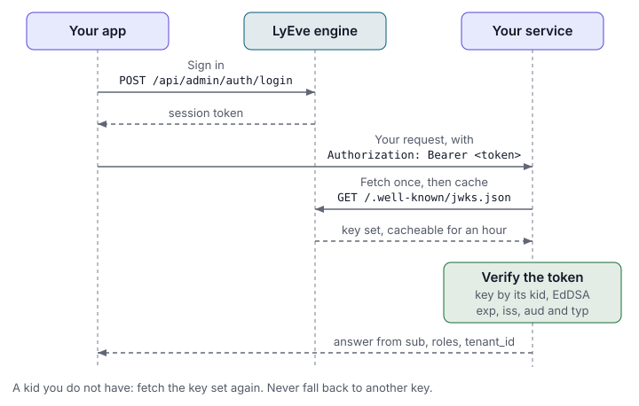

> **Included free** on every install.

When one of your services sits behind LyEve and needs to trust the caller, it
should not call LyEve on every request, and it must never hold the signing
secret. LyEve signs session tokens with **EdDSA (Ed25519)** and publishes the
matching **public** key at a standard JWKS endpoint. Your service fetches the
key once, caches it, and verifies tokens itself. This is the pattern OIDC
providers use, so a library that validates Google or Auth0 tokens works here
too.



:::tip[Best for]
- **An API of your own behind LyEve.** Accept the same token the admin console
  holds, and read the caller's roles and tenant from it.
- **An edge function or gateway.** Reject unsigned or expired tokens before
  they reach anything else.
- **Per-tenant data in another service.** Scope every query by the verified
  `tenant_id`, never by a value the client sends.
:::

## Try it

Admin console v0.22.0 has no screen of its own for the key set or for checking a token, so these
steps use the engine API.

1. Fetch the key set from the Content API:

   ```bash
   curl -i http://localhost:3002/.well-known/jwks.json
   ```

   The answer carries `Cache-Control: public, max-age=3600` and one key:

   ```json
   {
     "keys": [
       { "kty": "OKP", "crv": "Ed25519", "x": "b64url-of-32-byte-public-key", "use": "sig", "alg": "EdDSA", "kid": "b64url-8-bytes" }
     ]
   }
   ```

   An answer of `{"keys": []}` means the instance signs with HMAC, and its
   token header in step 3 reads `{"alg":"HS256","typ":"JWT"}`. See
   [when the key set is empty](#when-the-key-set-is-empty).

2. Sign in and keep the `token` from the answer in `TOKEN`. The
   [quickstart](../getting-started/quickstart.md) shows how.

3. Read the token's header:

   ```bash
   echo "$TOKEN" | cut -d. -f1 | base64 -d 2>/dev/null; echo
   ```

   ```json
   {"alg":"EdDSA","kid":"b64url-8-bytes","typ":"JWT"}
   ```

   The `kid` matches the key in step 1.

4. Verify it in your service with one of the examples below.

## The endpoint

```http
GET /.well-known/jwks.json
```

- **Public.** No authentication.
- **Served by the Content API** only, on port 3002 by default
  (`API_LISTEN_ADDR`). The Admin API answers `404` for this path.
- **RFC 7517** JWK Set format.
- Cache it for up to an hour, as `Cache-Control` says, rather than fetching it
  per request.

| Field | Value | Meaning |
|---|---|---|
| `kty` | `OKP` | Octet key pair, the RFC 8037 family for Ed25519 |
| `crv` | `Ed25519` | The curve |
| `x` | base64url | The raw 32-byte public key |
| `use` | `sig` | A signature key |
| `alg` | `EdDSA` | The signing algorithm |
| `kid` | base64url | Key ID. The same key always has the same `kid`. |

### When the key set is empty

```json
{ "keys": [] }
```

An empty set means the instance signs with HMAC instead: `JWT_ALG=HS256` is
set, or, outside production, the key file at `JWT_KEY_PATH` could not be used.
That covers a file that cannot be read or created, does not parse, holds a key
of the wrong length, or holds a public key that does not match its seed. In
production any of these stops the start instead. HMAC
tokens can only be checked with `JWT_SECRET`, so do not use JWKS validation
against such an instance. See
[sign tokens with Ed25519](../how-to/secure-your-instance.md#2-sign-tokens-with-ed25519).

## What a token holds

| Claim | Type | Notes |
|---|---|---|
| `sub` | string | User ID (UUID) |
| `email` | string | The user's email. On an install with several tenants, the same address can belong to a different account in each tenant, so identify an account by `sub` |
| `roles` | string[] | The user's roles in the tenant the session acts in |
| `tenant_id` | string | The tenant. Absent for an account with no tenant, such as the first super admin |
| `typ` | string | `session` for a normal token, `challenge` for one waiting on a second factor |
| `tv` | int | Token version. The instance raises it to end every session of an account |
| `jti` | string | A unique ID for the token |
| `iss` | string | Always `lyeve-cms` |
| `aud` | string[] | Always `["lyeve-api"]` |
| `iat`, `exp` | numeric date | Issued at and expiry. The lifetime is `JWT_EXPIRY_SECS`, 900 seconds by default |

Three checks matter most to a downstream service:

- **`iss` must equal `lyeve-cms` and `aud` must contain `lyeve-api`.** Reject
  anything else, so a token minted for another audience is not replayed
  against you.
- **`typ` must be `session`.** A `challenge` token means the person entered a
  password and has not cleared MFA yet.
- **`tenant_id` is your isolation boundary.** Never trust a tenant value from
  anywhere but the verified token. See [tenants](../features/tenants.md).

A signature check alone cannot see that an account was disabled or signed out
after the token was issued. Keep `JWT_EXPIRY_SECS` short, so such a token
expires within minutes.

## Verify a token

The steps are the same in any language:

1. Fetch the key set once, then cache it for the `max-age`.
2. Read the token's `kid` header and pick the key with that `kid`.
3. Verify the signature with that key, requiring `alg` `EdDSA`.
4. Check `exp`, `iss` and `aud`, and that `typ` is `session`.
5. Read `sub`, `roles` and `tenant_id` from the verified claims.

If you meet a `kid` you do not have, fetch the key set again. Never fall back
to another key.

### Go

```go
package lyeveauth

import (
	"crypto/ed25519"
	"encoding/base64"
	"encoding/json"
	"fmt"
	"net/http"

	"github.com/golang-jwt/jwt/v5"
)

type jwk struct {
	Kty, Crv, X, Kid string
}

// LoadKeys fetches the JWKS and returns kid -> ed25519 public key.
func LoadKeys(jwksURL string) (map[string]ed25519.PublicKey, error) {
	resp, err := http.Get(jwksURL)
	if err != nil {
		return nil, err
	}
	defer resp.Body.Close()

	var set struct{ Keys []jwk }
	if err := json.NewDecoder(resp.Body).Decode(&set); err != nil {
		return nil, err
	}

	keys := map[string]ed25519.PublicKey{}
	for _, k := range set.Keys {
		if k.Kty != "OKP" || k.Crv != "Ed25519" {
			continue
		}
		raw, err := base64.RawURLEncoding.DecodeString(k.X)
		if err != nil || len(raw) != ed25519.PublicKeySize {
			continue
		}
		keys[k.Kid] = ed25519.PublicKey(raw)
	}
	return keys, nil
}

// Verify parses and validates a LyEve token. Cache keys between calls.
func Verify(tokenStr string, keys map[string]ed25519.PublicKey) (jwt.MapClaims, error) {
	parser := jwt.NewParser(
		jwt.WithValidMethods([]string{"EdDSA"}),
		jwt.WithIssuer("lyeve-cms"),
		jwt.WithAudience("lyeve-api"),
	)
	claims := jwt.MapClaims{}
	_, err := parser.ParseWithClaims(tokenStr, claims, func(t *jwt.Token) (any, error) {
		kid, _ := t.Header["kid"].(string)
		key, ok := keys[kid]
		if !ok {
			return nil, fmt.Errorf("unknown kid %q", kid)
		}
		return key, nil
	})
	if err != nil {
		return nil, err
	}
	if claims["typ"] != "session" {
		return nil, fmt.Errorf("not a session token")
	}
	return claims, nil
}
```

`WithValidMethods([]string{"EdDSA"})` is the line that matters: it stops a
token from naming `none` or an HMAC algorithm instead.

### Node.js

The `jose` library fetches, caches and picks the key for you:

```js
import { jwtVerify, createRemoteJWKSet } from 'jose';

const JWKS = createRemoteJWKSet(
  new URL('https://lyeve.example.com/.well-known/jwks.json'),
);

export async function verify(token) {
  const { payload } = await jwtVerify(token, JWKS, {
    issuer: 'lyeve-cms',
    audience: 'lyeve-api',
    algorithms: ['EdDSA'],
  });
  if (payload.typ !== 'session') throw new Error('not a session token');
  return payload; // { sub, roles, tenant_id, ... }
}
```

`createRemoteJWKSet` fetches on first use and fetches again when it meets an
unknown `kid`.

## Key rotation

The signing key lives in the file at `JWT_KEY_PATH`
(`/var/lib/lyeve/jwt_key.json` by default), and LyEve creates it on first
start when the file is missing. To rotate, replace the file and restart. The
instance verifies with one key at a time, so it refuses every token signed
with the old key, and new tokens carry the new `kid`. A service that fetches
the key set again on an unknown `kid` picks up the new key without a change.
A service keeps accepting a token signed with the old key until the token
expires or the service fetches the key set again.

## Related

- [Harden your instance](../how-to/secure-your-instance.md): signing, secrets
  and token lifetimes.
- [Roles and permissions](../guides/user/roles-and-permissions.md): what the
  roles in a token mean.
- [Sign-in options](oauth-sso.md): every way a person gets a token.
