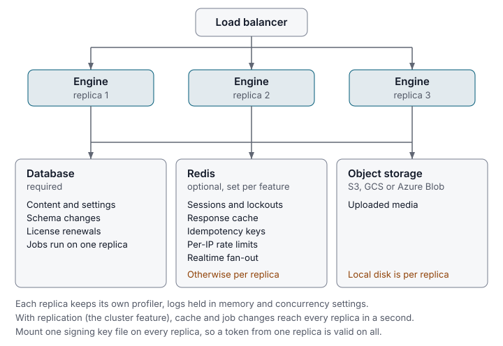

One replica on a well-sized database serves a lot of traffic. This page helps
you decide when that stops being true, what more than one replica needs, and
which settings to tune first.

| If you want to | Read |
|---|---|
| Know whether one replica is enough | [When one replica is enough](#when-one-replica-is-enough) |
| Run several replicas behind a load balancer | [Run more than one replica](#run-more-than-one-replica) |
| Send some reads to a read replica | [Read replicas](#read-replicas) |
| Stop requests waiting for database connections | [Size the connection pool](#size-the-connection-pool) |
| Answer repeated reads without the database | [Caching](#caching) |
| Fail fast instead of slowing down under overload | [Shed load before the database does](#shed-load-before-the-database-does) |
| Deploy without dropping requests | [Shutdown and rolling deploys](#shutdown-and-rolling-deploys) |
| Keep tracing from becoming the bottleneck | [Tracing under load](#tracing-under-load) |

Every setting below is an environment variable. The full list is in
[configuration](../reference/configuration.md).

## When one replica is enough

One replica is enough while it keeps up and you can accept a short outage when
it restarts. Watch three numbers:

- **Request latency.** The p95 per endpoint, from
  [request profiling](../features/request-profiling.md) or
  [metrics export](../features/metrics-export.md).
- **Pool waits.** `wait_count` on the pool health answer, below. Waits that
  keep growing mean requests queue for a database connection.
- **CPU and memory** of the replica's container.

If latency rises with traffic while the pool has free connections, the
replica is the limit: add a replica. If requests wait for connections, raise
the pool first. If the database itself is saturated, move to a bigger database, because more
replicas only add more connections. A [read replica](#read-replicas) takes
only a few reads off it.

## Run more than one replica

Run several replicas behind a load balancer, each connected to the same
database. They share the database and nothing else by default, so a deployment
of more than one replica needs three things:

1. **The same signing key on every replica.** Each replica creates a key at
   `JWT_KEY_PATH` on first boot, and a token signed by one fails on another.
   Mount one key file on all of them. See
   [Kubernetes](../deploy/kubernetes.md#the-signing-key).
2. **One Redis for all of them.** Set `CACHE_DRIVER=redis`,
   `RATE_LIMIT_BACKEND=redis`, and `REALTIME_BACKEND=redis` where realtime is
   used, with `REDIS_URL` pointing at one Redis. The Redis cache, rate limit
   and idempotency store are included free on every install.
3. **Media in a bucket.** Uploads on local disk stay on one replica. Use
   [object storage](../features/object-storage.md).

Set `LYEVE_SETUP_TOKEN` too if no account exists yet. Without it each replica
prints a setup token of its own, and setup works only on the replica whose
token you present.

### What is per replica and what is shared



| State | Across replicas |
|---|---|
| Token signing key | Per replica unless every replica has the same key file. |
| Sessions, sign-in lockouts and two-factor limits | Per replica unless `CACHE_DRIVER=redis` and `REDIS_URL` are set. Per replica, a refresh that reaches another replica answers `401` and signs the user out, N replicas admit N times the failed sign-in and two-factor limits, and a restart lifts a lockout. With Redis, replicas share one limit, a restart keeps a lockout, and a sign-in is refused while Redis cannot be read. The boot log's `refresh token store` line says which applies. |
| Content cache | Per replica unless `CACHE_DRIVER=redis`. See [caching](../features/caching.md). |
| Idempotency keys | Per replica unless `REDIS_URL` reaches a Redis at start. See [idempotent requests](../features/idempotent-requests.md). |
| Per-IP rate limit | Per replica unless `RATE_LIMIT_BACKEND=redis`, which counts in Redis at `RATE_LIMIT_REDIS_URL`, or `REDIS_URL` when that is unset. Per replica, N replicas admit N times the limit. See [rate limiting](../features/rate-limiting.md). |
| Realtime fan-out | Per replica unless `REALTIME_BACKEND=redis`, which relays events through `REALTIME_REDIS_URL`, or `REDIS_URL` when that is unset. Per replica, a client hears only what its own replica published. The `Last-Event-ID` resume buffer stays per replica. See [realtime](../features/realtime.md). |
| Uploaded media | Per replica on local disk. Use an S3-compatible bucket. |
| Schema changes | Shared. Every replica sees a schema change within about a second. |
| Permission, content and query caches | Shared within about a second with [replication](../features/replication.md), which needs a license with the `cluster` feature. Without it a change reaches other replicas when their cache entries expire. |
| License renewals | Shared. A renewal is stored in the database, and a replica that starts later applies it at boot. A newer key in `LYEVE_LICENSE_KEY` wins. |
| Scheduled jobs | One replica runs the schedule at a time. A job created on any replica reaches the schedule within about a second. |
| Webhook retries, scheduled publishing, synthetic probes and data export schedules | Each run happens on one replica. |
| Message broker relay | One replica publishes at a time, and each event is published once. See [message broker events](../features/message-broker-events.md). |
| Profiler, logs held in memory, concurrency settings | Per replica. Each replica answers for itself. |

### Migrations and schema changes

Each replica applies pending migrations when it boots, under a database lock,
so replicas that start together apply each migration once. A schema change can
be saved on any replica. A save that meets another replica's change to the
same schema answers `503` with `Retry-After: 1`, and succeeds when retried.

### Name and see the replicas

Set `INSTANCE_ID` to name a replica in logs, traces and the replica list.
Unset, it is the hostname and the process id. With
[replication](../features/replication.md),
`GET /api/admin/cluster/instances` lists the running replicas for a super
admin.

To send content events to other systems, use
[message broker events](../features/message-broker-events.md). Replicas do not
need it to stay in step with each other.

## Read replicas

Set `DATABASE_REPLICA_URL` to a read replica of your database. The instance
sends a few reads that tolerate lag to the replica, such as the content type
list and the dashboard figures, and everything else, content reads included,
to the primary. `DATABASE_REPLICA_MAX_CONNS`
caps that pool (default `30`). If the replica cannot be reached at boot, the
instance logs a warning and reads from the primary.

For database high availability, use your database's own tooling: Patroni for
PostgreSQL, InnoDB Cluster for MySQL, or Always On availability groups for SQL
Server. Point `DATABASE_URL` at the address that follows the primary.

## Size the connection pool

The connection pool is what most deployments tune first.

| Variable | What it does | Default |
|---|---|---|
| `DATABASE_MAX_CONNECTIONS` | Ceiling on open connections to the primary. | `25` |
| `DB_POOL_MIN_CONNS` | Connections opened at boot, so the first requests skip the handshake. They close when idle like any other. | `2` |
| `DB_CONN_MAX_LIFETIME` | Age at which a connection is retired. | `1h` |
| `DB_POOL_HEALTH_CHECK_PERIOD` | Idle time before a connection is closed. | `30s` |
| `DB_CONN_MAX_IDLE_TIME` | Has no effect: `DB_POOL_HEALTH_CHECK_PERIOD` always sets the idle time. | `5m` |
| `DATABASE_REPLICA_MAX_CONNS` | Ceiling for the read replica. | `30` |

Durations are written like `90s`, `15m` or `2h`. A value that does not parse
stops the boot with a message naming the variable.

The defaults are conservative. A busy Content API usually wants
`DATABASE_MAX_CONNECTIONS` raised well past 25. If traffic comes in bursts with
quiet gaps, raise `DB_POOL_HEALTH_CHECK_PERIOD` so idle connections stay open
between bursts. Keep `DATABASE_MAX_CONNECTIONS` times the number of replicas
under the database's own connection limit.

### Watching the pool

`GET /api/admin/pool/health` returns a live snapshot of the pool for an admin
or super admin:

```bash
curl http://localhost:3001/api/admin/pool/health \
  -H "Authorization: Bearer $TOKEN"
```

```json
{ "engine": "postgres", "healthy": true, "latency_ms": 0.646, "open_connections": 4, "in_use": 1, "idle": 3, "max_open_connections": 25, "wait_count": 0, "wait_duration_ms": 0, "max_idle_closed": 0, "max_lifetime_closed": 0, "stmt_cache_max_size": 100, "utilization": 0.04, "utilization_warning": false }
```

The real answer also carries `slow_queries`, the slowest statement shapes the
pool has seen, ranked by maximum and by average duration.
`utilization_warning` turns on above `0.8` whatever the thresholds below say.

Three thresholds decide when it reports the pool as unhealthy:

| Variable | What it does | Default |
|---|---|---|
| `POOL_HEALTH_MAX_LATENCY` | Slowest ping still counted as healthy. | `1s` |
| `POOL_HEALTH_MIN_IDLE` | Idle connections below which the pool is unhealthy. | `1` |
| `POOL_HEALTH_MAX_UTIL` | Utilization above which the pool is unhealthy, greater than `0` and at most `1`. | `0.9` |

An out-of-range value is discarded and the default applies, with no message.
`POOL_HEALTH_MAX_UTIL` takes a ratio such as `0.8`, not a percentage.

### An external pooler

To put PgBouncer or ProxySQL in front of the database, point `DATABASE_URL` at
the pooler and size the pooler in its own configuration.

:::caution
`CONNECTION_POOLER`, `POOL_MAX_CLIENT_CONN`, `POOL_DEFAULT_POOL_SIZE`,
`POOL_RESERVE_POOL_SIZE` and `POOL_TENANT_SIZES` are read at boot but change
nothing: the instance neither configures the pooler nor reports these values.
Invalid JSON in `POOL_TENANT_SIZES` still prints a warning when
`CONNECTION_POOLER` is `pgbouncer` or `proxysql`.
:::

## Caching

[Caching](../features/caching.md) is included free on every install, Redis
included. With no settings it caches in each replica's memory. Set
`CACHE_DRIVER=redis` and `REDIS_URL` to share one cache across replicas.
Entry lifetimes and failover between cache servers are on the caching page.

## Shed load before the database does

Load shedding is off by default. Switched on, it caps concurrent requests and
starts refusing before the connection pool saturates, so an overloaded replica
answers a fast `503` that the load balancer can route around instead of
slowing down for everyone.

| Variable | What it does | Default |
|---|---|---|
| `BACKPRESSURE_ENABLED` | Switches load shedding on. | `false` |
| `BACKPRESSURE_MAX_INFLIGHT` | Concurrent requests allowed before shedding. | `200` |
| `BACKPRESSURE_TENANT_QUOTA_PCT` | Share of that budget any one tenant may hold, so one busy tenant cannot take it all. | `0.4` |
| `BACKPRESSURE_POOL_PRESSURE_THRESHOLD` | Pool utilization at which shedding begins. | `0.85` |

Probe paths are never shed. For the worker pools inside a replica, see
[concurrency tuning](../features/concurrency-tuning.md).

## Shutdown and rolling deploys

| Variable | What it does | Default |
|---|---|---|
| `PRESTOP_DRAIN_SECS` | Seconds `/readyz` answers `503` before shutdown starts, so the load balancer stops sending traffic first. | `5` |
| `GRACEFUL_SHUTDOWN_SECS` | Seconds in-flight requests get to finish. | `60` |
| `MEMORY_LIMIT_BYTES` | Memory ceiling the instance sizes itself against. Read only when the container's cgroup sets no memory limit. | from the cgroup |

`PRESTOP_DRAIN_SECS` and `GRACEFUL_SHUTDOWN_SECS` decide whether a rolling
deploy drops requests. The drain has to outlast the load balancer's
health-check interval, and your platform's shutdown grace period has to cover
both. On Kubernetes that is `terminationGracePeriodSeconds`, which defaults to
30, so raise it past the 65 seconds the defaults need.

## Tracing under load

| Variable | What it does | Default |
|---|---|---|
| `OTEL_EXPORTER_OTLP_ENDPOINT` | OpenTelemetry collector to export traces to. | unset |
| `OTEL_EXPORTER_OTLP_INSECURE` | `true` sends to the collector without TLS. Any other value keeps TLS. | `false` |
| `TRACING_SAMPLING_RATE` | Share of traces kept, `0.0` to `1.0`. A value outside that range stops the boot. | `1.0` |
| `TRACING_TENANT_SAMPLING_RATES` | Per-tenant overrides as comma-separated `tenant=rate` pairs. A malformed pair stops the boot. | unset |

The default keeps every trace. That suits one replica. Behind real traffic,
lower it, or the collector becomes the bottleneck. Metrics go out separately,
through [metrics export](../features/metrics-export.md).

## Tokens from other issuers

`TRUSTED_ISSUERS` lists external OIDC issuer base URLs, comma-separated, whose
tokens the Content API accepts. The instance fetches each issuer's keys from
`{issuer}/.well-known/jwks.json`.

Each user of an issuer gets an account of their own in the tenant that the
issuer's entry in `TRUSTED_ISSUER_POLICIES` names, created on their first
request. The account keeps the address from the token only when the token
marks that address verified. When the tenant already holds an account for
that address, the token is refused and the request counts as anonymous, so a
user of an issuer never takes over an account the tenant created. An account
with the same address in another tenant does not affect any of this.

## Related

- [Production checklist](../deploy/production-checklist.md): what to check
  before going live.
- [Kubernetes](../deploy/kubernetes.md): manifests, the signing key and
  probes.
- [Replication](../features/replication.md): keep replica caches in step.
- [Request profiling](../features/request-profiling.md): find what is slow
  before you scale.
